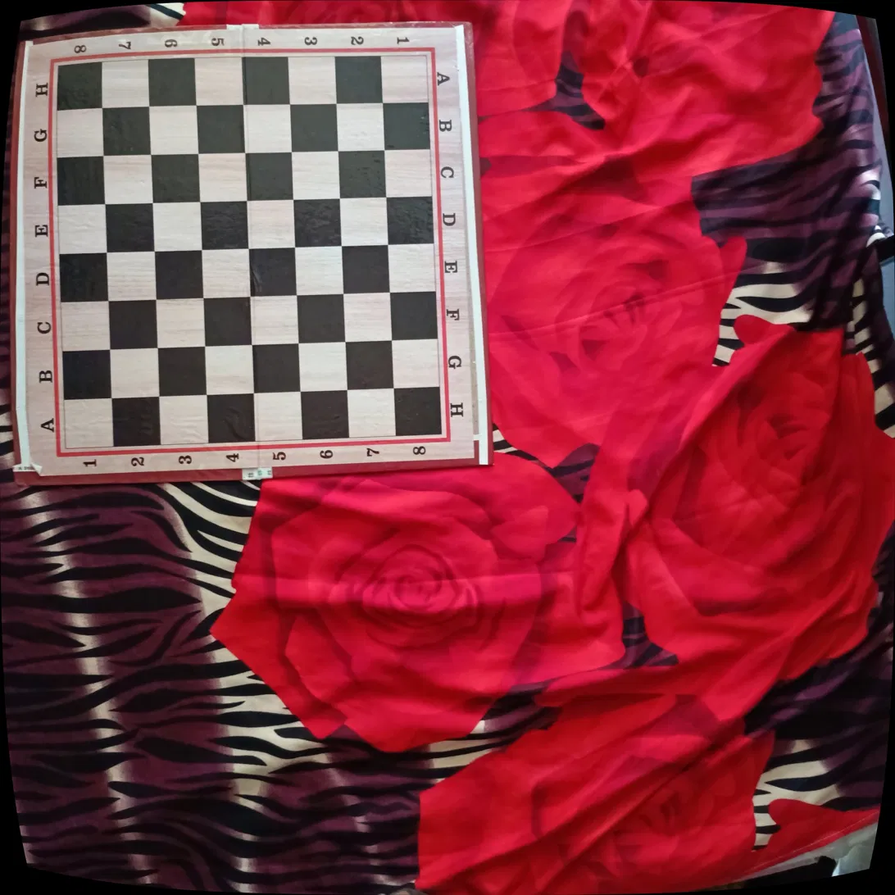
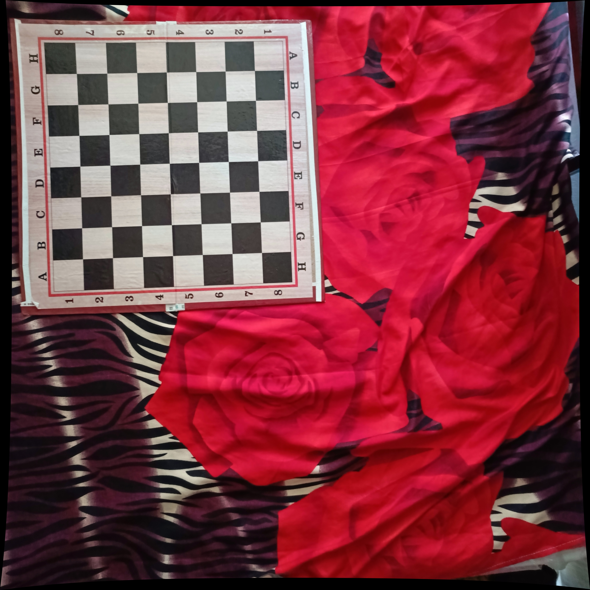
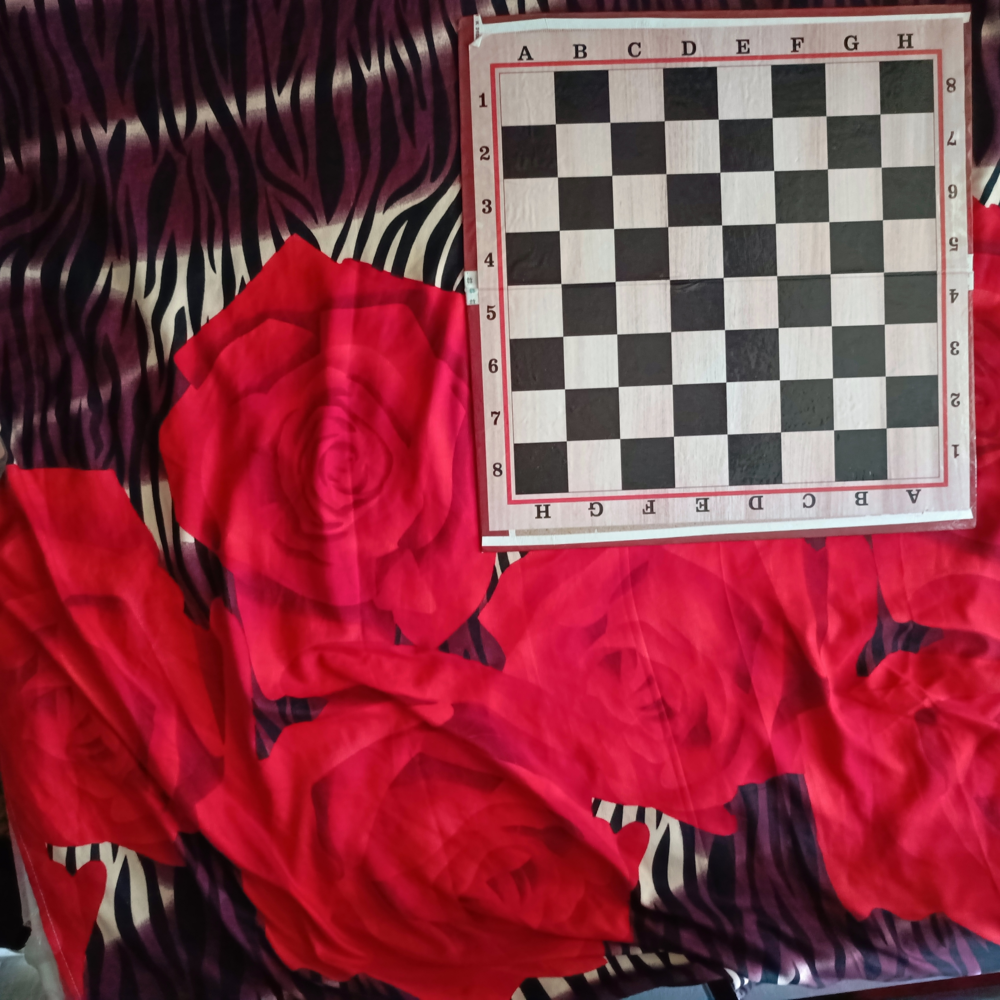

Board: 8×8 squares (7×7 inner corners), screen/paper-displayed, square size 48.25mm

Challenge 1: symmetric board caused corner-ordering ambiguity → physically impossible K values → fixed by enforcing consistent board orientation during capture

Challenge 2: unconstrained k3 overfit → visible pincushion warping despite lower numeric error → fixed with CALIB_FIX_K3

Final: 
Reprojection error: 2.1628016509257306
Camera matrix (K):
 [[4.57905656e+03 0.00000000e+00 1.75765543e+03]
 [0.00000000e+00 4.75855233e+03 1.59355587e+03]
 [0.00000000e+00 0.00000000e+00 1.00000000e+00]]
Distortion coefficients:
 [[ 0.10534524 -0.68791628 -0.0012553  -0.00100913  0.        ]]
 

Honest limitation: still above the 0.5px target; note likely cause (limited edge-of-frame corner coverage) and what more time would fix

## Undistortion Verification

**Before fix (unconstrained k3, overfit model):**

**After fix (CALIB_FIX_K3):**

**Original raw image for comparison:**

## Calibration Images

Full set of 19 raw calibration images used for this process is available here:
[Google Drive — Calibration Images](https://drive.google.com/drive/folders/1oHZE6fndolY465ghD-MWcZwH-EmkIaRv?usp=sharing)
