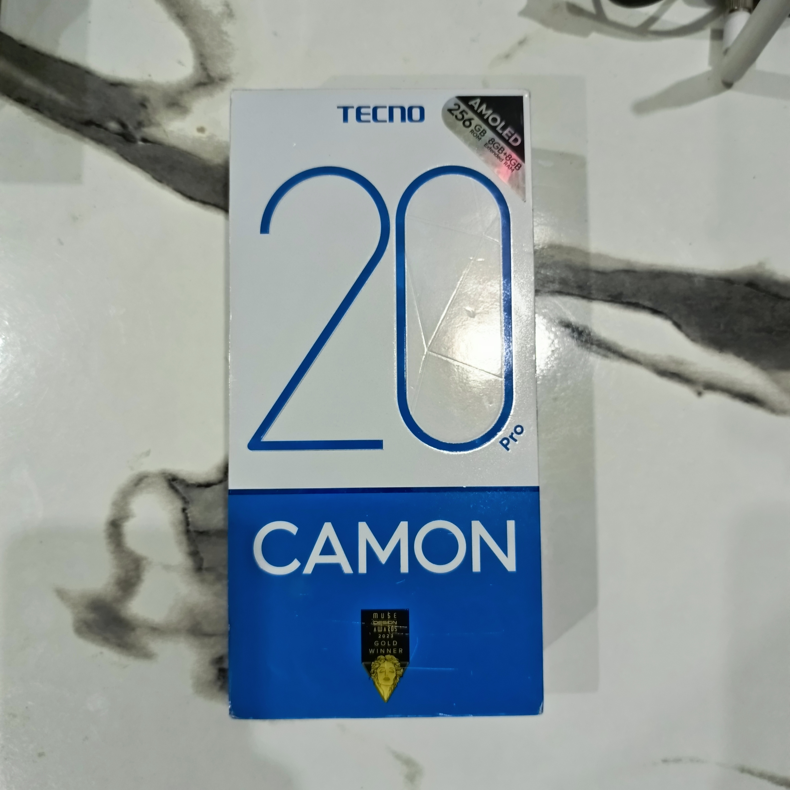
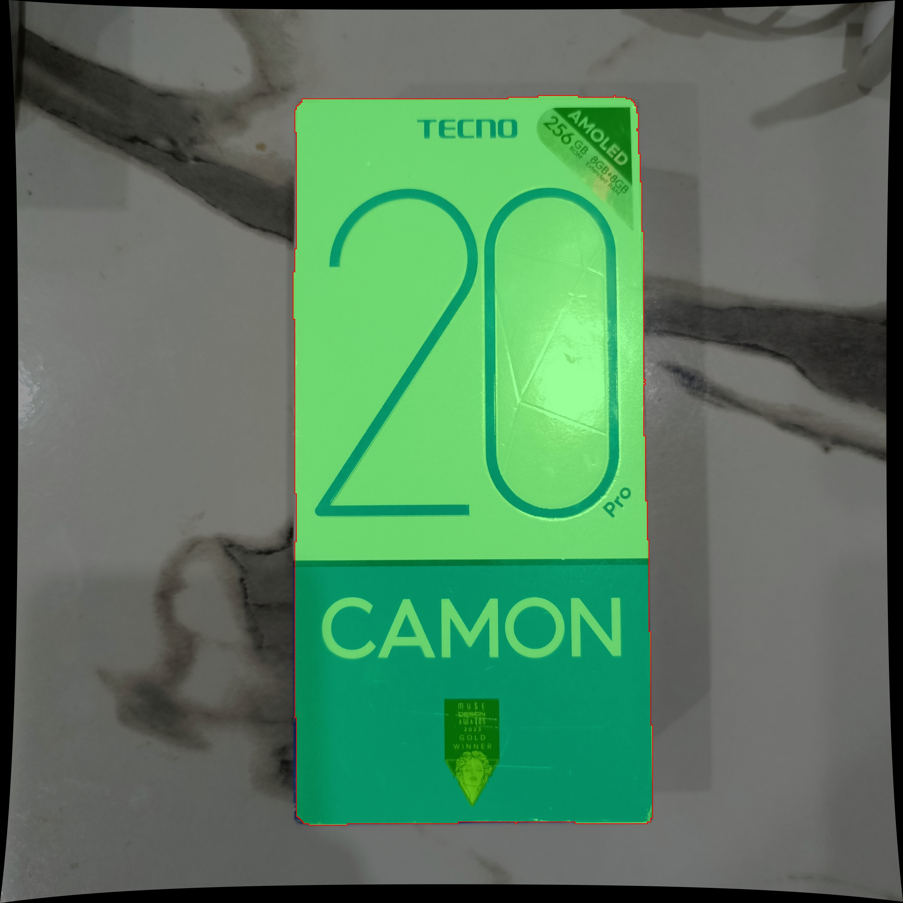
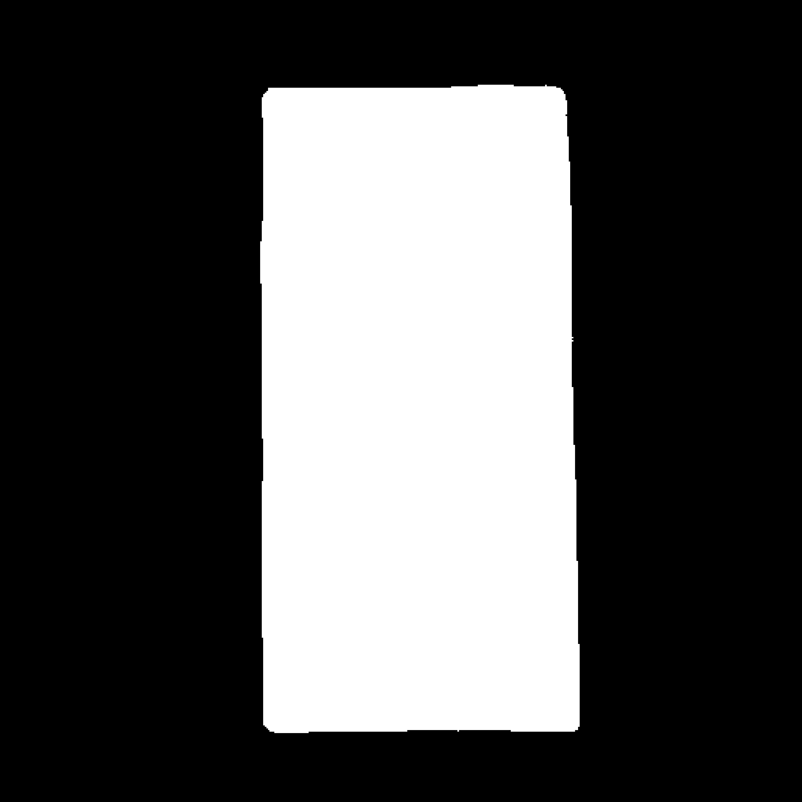

Requirements: pip install -r requirements.txt (make sure segmentation-models-pytorch, opencv-python, torch, numpy are listed there).
Usage: python inference/inference.py --image path/to/photo.jpg --output path/to/result.jpg

Expected input: a raw (not pre-undistorted) photo taken with the calibrated camera.

Expected output: two files — result.jpg (overlay + contour) and result_mask.jpg (raw binary mask).

Sample input/output pair: 

input.jpg:
.

result.jpg:
.

result_mask.jpg:
.