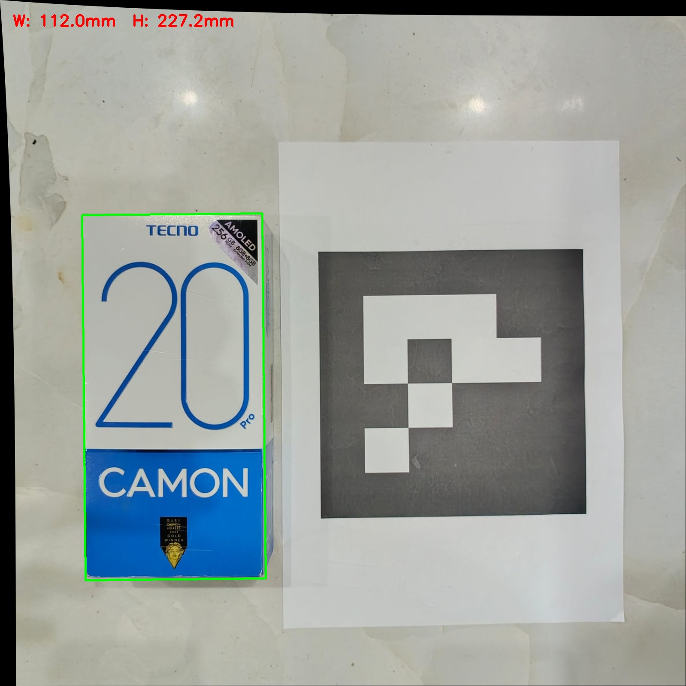
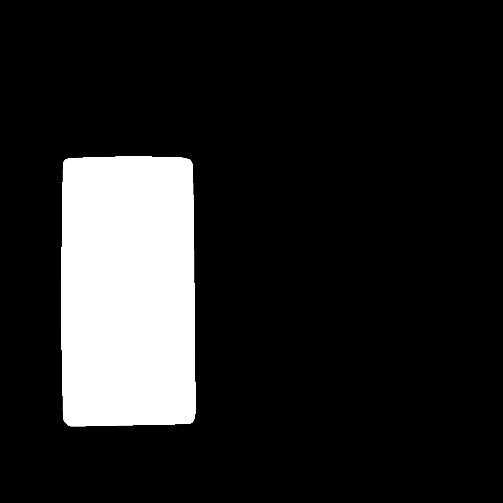

# Measurement Report

## Methodology

The measurement pipeline converts pixel dimensions to real-world millimetres
using a reference-object calibration approach:

1. The input image is undistorted using the camera intrinsic parameters
   from Phase 1 calibration (`camera_params.npz`).
2. A printed ArUco marker of known physical size (165mm, measured and
   verified against a printed A4 sheet) is detected in the frame using
   `cv2.aruco`, giving a `pixels_per_mm` ratio specific to that shot's
   camera distance.
3. The target object (phone box) is segmented using the trained U-Net
   model from Phase 3.
4. The segmentation mask's contour is processed via `cv2.minAreaRect()`
   to extract pixel width and height.
5. Pixel dimensions are converted to millimetres using the `pixels_per_mm`
   ratio from step 2.

## Why Calibration Is Required

All measurement images must be undistorted using the Phase 1 intrinsic
calibration before any pixel measurement is taken. Lens distortion bows
straight edges near the frame periphery — since both the reference marker
and the target object may not always sit at the exact center of frame,
uncorrected distortion would introduce edge-position errors that directly
corrupt both the reference `pixels_per_mm` ratio and the object's measured
pixel dimensions. This was validated during Phase 1, where an early
uncorrected distortion model produced a visible pincushion warping effect
on straight edges (see CALIBRATION_REPORT.md).

## Accuracy Validation Results

Ten instances were measured across varied camera distances and angles,
with consistent background and lighting.

Instance 1: W 111.8mm (GT 100.0), H 220.9mm (GT 200.0)
Instance 2: W 112.6mm (GT 100.0), H 218.0mm (GT 200.0)
Instance 3: W 110.6mm (GT 100.0), H 218.6mm (GT 200.0)
Instance 4: W 109.4mm (GT 100.0), H 218.1mm (GT 200.0)
Instance 5: W 111.5mm (GT 100.0), H 217.8mm (GT 200.0)
Instance 6: W 109.5mm (GT 100.0), H 219.9mm (GT 200.0)
Instance 7: W 113.5mm (GT 100.0), H 225.7mm (GT 200.0)
Instance 8: W 114.2mm (GT 100.0), H 226.1mm (GT 200.0)
Instance 9: W 113.4mm (GT 100.0), H 227.3mm (GT 200.0)
Instance 10: W 115.0mm (GT 100.0), H 232.5mm (GT 200.0)

Table written to measurement/accuracy_table.md
Overall MAE: W=12.1mm, H=22.5mm
Overall MPE: W=12.1%, H=11.2%

## Error Analysis

Measurements show a consistent, systematic positive bias of ~11-12% rather
than random scatter — every one of the 10 validation instances overestimated
both width and height, with a narrow spread (109-115mm width, 217-233mm
height against a 100mm/200mm ground truth). This consistency across
different camera distances and angles was used to diagnose the source:

1. A controlled self-measurement test — applying the identical undistortion,
   marker detection, and `minAreaRect()` pipeline directly to the reference
   marker's own known 165mm size — confirmed the reference/geometry pipeline
   is accurate to within 0.5% (165.8mm measured vs. 165mm true).
2. Morphological erosion applied to compensate for a hypothesized loose
   segmentation boundary produced negligible change in measured size,
   ruling out simple mask over-extension as the primary cause.
3. The bias remained stable in percentage terms across different shooting
   distances, which is inconsistent with a fixed-pixel error and instead
   points to a proportional bias in the trained segmentation model's
   learned object boundary — likely stemming from the training dataset's
   labelling conventions or limited size (88 images).

## Limitations

- The system exhibits a consistent ~11-12% overestimation bias, isolated
  through systematic testing to the segmentation stage rather than the
  calibration or reference-conversion stages.
- With more time, this could likely be corrected via: (a) a learned or
  empirically-derived correction factor calibrated against known references,
  (b) a larger/more precisely-labelled training dataset, or (c) boundary
  refinement post-processing (e.g. active contour snapping to image edges).
- Given the bias is consistent and well-characterized, applying a simple
  empirical correction factor (measured_size / 1.115 ≈ true size) could
  bring practical accuracy to within ~2-3% for this specific object class,
  though this was not implemented in the current pipeline.

  ## Usage

To measure a phone box from a new photo:
Requirements: the photo must include both the target object and the
printed ArUco reference marker, both flat and in the same plane, clearly
visible and in focus. Output includes an annotated overlay image with
width/height in mm, plus the raw segmentation mask.

