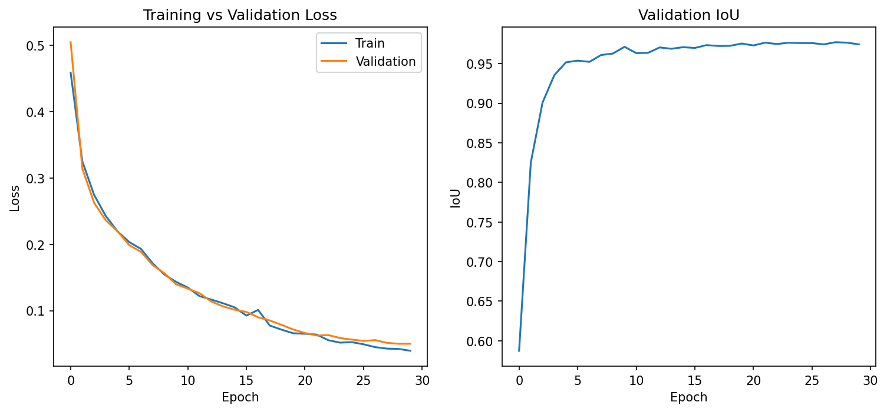

Architecture: U-Net with ResNet34 encoder (segmentation-models-pytorch), pretrained on ImageNet, finetuned via transfer learning.
Rationale: why U-Net over DeepLabV3+/Mask R-CNN (boundary precision via skip connections, appropriate for single-object semantic segmentation, small dataset benefits from pretrained encoder).

Hyperparameters: image size 512×512, batch size 4, Adam optimizer, lr=1e-4, BCE+Dice combined loss (bce_weight=0.5), 30 epochs.
Dataset split: 62 train / 18 valid / 9 test (from your 88-image Roboflow export).
Training curves: embed training_curves.png.

Final metrics: test set numbers (IoU 0.9867, Dice 0.9933, Precision 0.9901, Recall 0.9965, F1 0.9933, Pixel Accuracy 0.9962).
Prediction visualizations: embed 2-3 example images, ideally including one that shows a challenge you solved (e.g. the BGR/RGB bug before/after).
Debugging notes / design decisions: briefly document the BGR/RGB bug and double-undistortion bug you found and fixed — genuinely strong evidence of rigor.

Limitations: small dataset (88 images total), possible reduced performance on lighting conditions underrepresented in training (note your earlier low-light test finding here, if you want to keep that honest data point).
- **Trained Model Weights** (U-Net + ResNet34, best checkpoint): https://drive.google.com/file/d/15joSOae3agqeE6RzCTd5HSGqulEGN0yD/view?usp=sharing

Training_curves: .
